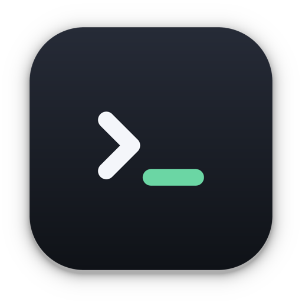

# Tether

Tether 把电脑上的终端带到手机上。终端照旧在你的 Mac、Windows 或 Linux 电脑上运行，手机用浏览器打开就是同一个会话，输出实时同步，也能直接打字。程序问你 (y/n)、AI 助手等你回话、长命令跑完的时候，Tether 会提醒你，回答直接做成按钮。

- 手机不用装 App：浏览器打开电脑的地址，添加到主屏幕就行。
- 不用账号，中间也没有服务器：手机直接连到电脑，终端内容端到端加密。
- 不在同一个 Wi-Fi 时，按 Tether 里的「出门在外」向导配好 Tailscale，在哪儿都能连，锁屏时也能收到提醒。
- 电脑上的窗口可以分屏，最多并排 9 个终端。退出或重启以后，终端回到原来的目录，之前的输出也在。

## 下载

在[下载页](https://joyce1998.github.io/Tether/download.html)选你的系统：

- **Mac**：macOS 12 或更高版本，Apple 芯片和 Intel 处理器都有。
- **Windows**：Windows 10（1903 或更高版本）或 Windows 11，x64 和 ARM64 都有。
- **Linux**：64 位，Ubuntu、Debian 用 .deb，其他发行版用 AppImage，x64 和 arm64 都有。

安装包也可以在这个仓库的 [Releases](https://github.com/joyce1998/Tether/releases/latest) 里下载。装好以后，Tether 会自己检查更新。

## 文档

[使用文档](https://joyce1998.github.io/Tether/docs.html)里有安装、连接手机、出门在外、提醒与一键回复、快捷键、更新和常见问题。

---

这个仓库放的是 Tether 的网站 [joyce1998.github.io/Tether](https://joyce1998.github.io/Tether/) 和每个版本的安装包。
